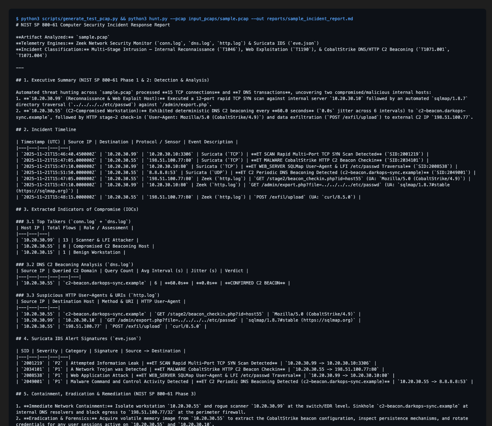

# pcap-threat-hunting-pipeline: Zeek & Suricata Network Forensics Pipeline

## Why I built this
When an incident response team gets handed a raw packet capture (`.pcap`), manually clicking through packets in Wireshark takes too long if you need to quickly identify who is scanning the network, whether a host is beaconing out to a Command-and-Control (C2) server, and which Suricata IDS signatures fired.

I built `hunt.py` to automate that network forensics workflow from a single command. It takes any `.pcap` file in `input_pcaps/`, generates structured **Zeek** logs (`conn.log`, `dns.log`, `http.log`) and **Suricata** alerts (`eve.json`), analyzes inter-arrival timestamps to detect periodic DNS C2 beaconing, extracts suspicious HTTP User-Agents and URIs, and writes a complete incident response report structured around **NIST SP 800-61** ([reports/sample_incident_report.md](reports/sample_incident_report.md)).

To make the pipeline testable out of the box without needing external malware captures, I also wrote [scripts/generate_test_pcap.py](scripts/generate_test_pcap.py) using `scapy` to synthesize a 22-packet multi-stage intrusion PCAP.

## How the pipeline works

```text
scripts/generate_test_pcap.py (Scapy)
        |
        v
input_pcaps/sample.pcap (22 packets: 12-port SYN scan + 60s DNS C2 beacon + CobaltStrike/sqlmap HTTP)
        |
        +---> Zeek Log Extraction      ---> logs/zeek/{conn.log, dns.log, http.log}
        |
        +---> Suricata Alert Engine    ---> logs/suricata/eve.json
        |
        v
   hunt.py (Top Talkers + DNS Beacon Interval/Jitter Math + HTTP IOCs + Suricata SIDs)
        |
        v
   reports/sample_incident_report.md (NIST SP 800-61 Incident Response Report)
```

### Why I combined Zeek and Suricata
Suricata and Zeek solve different halves of network threat hunting:
- **Suricata (`eve.json`)** is signature-driven: it immediately catches known bad patterns like the `CobaltStrike/4.9` HTTP User-Agent (`SID:2034101`), `sqlmap/1.8.7` directory traversal (`SID:2008538`), or rapid multi-port SYN scans (`SID:2001219`).
- **Zeek (`conn.log`, `dns.log`, `http.log`)** records protocol metadata for every transaction whether a signature fires or not. In `analyze_logs()`, I group `dns.log` queries by `(src_ip, query)`, sort their timestamps, and calculate the mean interval and jitter (`max(deltas) - min(deltas)`). That catches host `10.20.30.55` querying `c2-beacon.darkops-sync.example` 6 times at an exact **60.0-second interval (`0.0s` jitter)**.

## What `hunt.py` found in `input_pcaps/sample.pcap`
Full generated report: [reports/sample_incident_report.md](reports/sample_incident_report.md).

1. **Internal Reconnaissance & Web Exploitation (`10.20.30.99`)**:
   - Accounted for 13 of the 22 flows (`Top Talker #1`).
   - Swept 12 TCP ports (`21, 22, 23, 25, 80, 110, 139, 443, 445, 3306, 3389, 8080`) on internal server `10.20.30.10` (`SID:2001219`).
   - Sent `GET /admin/export.php?file=../../../../etc/passwd` with `User-Agent: sqlmap/1.8.7#stable` (`SID:2008538`).
2. **Compromised C2 Beaconing Workstation (`10.20.30.55`)**:
   - Sent 6 DNS A-record queries to `c2-beacon.darkops-sync.example` spaced 60.0 seconds apart (`0.0s` jitter -> `SID:2049001`).
   - Checked into external C2 server `198.51.100.77:80` (`GET /stage2/beacon_checkin.php?id=host55`, `User-Agent: Mozilla/5.0 (CobaltStrike/4.9)` -> `SID:2034101`) and exfiltrated credentials via `POST /exfil/upload` (`User-Agent: curl/8.5.0`).

### Pipeline execution and pytest output


## How to run it
```bash
# 1. Generate the synthetic intrusion PCAP using Scapy
python3 scripts/generate_test_pcap.py

# 2. Run the threat hunting CLI and output the NIST SP 800-61 report
python3 hunt.py --pcap input_pcaps/sample.pcap --out reports/sample_incident_report.md

# 3. Run the automated pytest verification suite
pytest -q tests
```
